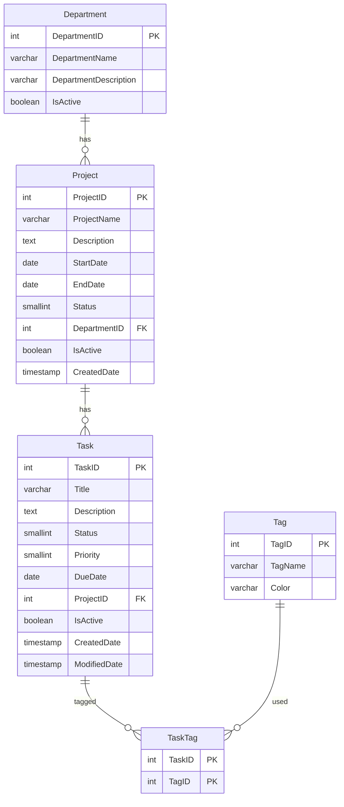

# TaskTrack API (PRN232 – Assignment 1, backend)

ASP.NET Core Web API (.NET 8) + EF Core + PostgreSQL. All endpoints are public (no login).

```
StudentID_ClassCode_Ass1_BE.sln
├── TaskTrack.API      Controllers, Program.cs, appsettings.json, middleware
├── TaskTrack.Repo     EF Core entities (Models), DbContext, Repositories
├── TaskTrack.Service  DTOs, service interfaces + implementations, business rules
└── db/                TaskManagementDB_Postgres.sql (schema + seed, not modified)
```

Controller → Service → Repository → DbContext. Controllers never touch the database directly.

## Run locally

1. Create a database and run the script:
   ```bash
   createdb TaskManagementDB
   psql -d TaskManagementDB -f db/TaskManagementDB_Postgres.sql
   ```
2. Put your password in `TaskTrack.API/appsettings.json` (`ConnectionStrings:DefaultConnection`)
   or set `DATABASE_URL`.
3. `dotnet run --project TaskTrack.API` → Swagger at http://localhost:5000/swagger

## Database-first scaffold

The models in `TaskTrack.Repo/Models` follow the scaffold output. To regenerate them from a live database:

```bash
dotnet tool install --global dotnet-ef
dotnet ef dbcontext scaffold "<connection>" Npgsql.EntityFrameworkCore.PostgreSQL \
  -o Models -c TaskManagementContext --force \
  --project TaskTrack.Repo --startup-project TaskTrack.API
```

(The scaffold names the table `Task` as class `Task`; here it is `TaskItem` to avoid clashing with `System.Threading.Tasks.Task`.)

## Configuration

| Name | Purpose |
| --- | --- |
| `DATABASE_URL` | PostgreSQL connection (URL or key=value). Overrides `appsettings.json`. |
| `ASPNETCORE_ENVIRONMENT` | `Production` on Render. |
| `CORS_ALLOWED_ORIGINS` | Frontend origin(s), comma separated (your Vercel URL). |
| `Swagger__Enabled` | Keeps Swagger on in Production (default `true`). |
| `PORT` | Set by Render; the app binds to it automatically. |

## Deploy on Render

1. New → PostgreSQL (free). Copy the **External** URL and run  
   `psql "<external-url>" -f db/TaskManagementDB_Postgres.sql`
2. New → Web Service → connect this GitHub repo → **Runtime: Docker** (uses the `Dockerfile`).
3. Environment: `DATABASE_URL` (use the **Internal** URL), `ASPNETCORE_ENVIRONMENT=Production`, `CORS_ALLOWED_ORIGINS=https://<your>.vercel.app`.
4. Open `https://<service>.onrender.com/swagger`.

## Business rules

- Delete department → HTTP 400 if it has projects. Delete project → HTTP 400 if it has tasks. Delete tag → HTTP 400 if any task uses it.
- Delete task is a soft delete (`IsActive = false`). Update task replaces its tags and sets `ModifiedDate`.
- Validation errors return HTTP 400 with a field-level `errors` object (ProblemDetails).

## ERD


